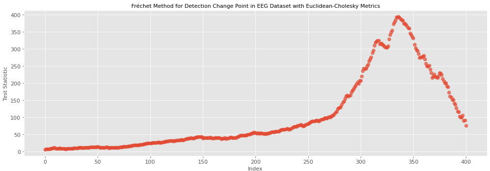

# Change-point detection for sequences of correlation matrices

Code for the dissertation *Change Point Detection for Correlation Matrices* (King's College London, Faculty of Natural, Mathematical & Engineering Sciences, September 2023).

A multivariate time series is divided into non-overlapping windows, and a correlation matrix is computed in each window. The resulting sequence of correlation matrices is tested for a single change point with two nonparametric methods, each combined with Cholesky-based metrics on the space of full-rank correlation matrices.



*Fréchet-based test statistic over candidate change points in the EEG recording (Euclidean-Cholesky metric, 1-second windows; the first and last 10% of the 500 windows are not scanned). Figure 6.2 of the dissertation.*

## Methods

- **Metrics.** Euclidean-Cholesky, Log-Euclidean-Cholesky and Poly-Hyperbolic-Cholesky metrics (Thanwerdas and Pennec, 2022). Each works on the Cholesky factor of a correlation matrix, so only the lower triangle is used.
- **Fréchet-based detection** (Dubey and Müller, 2020). The scan statistic compares the Fréchet means and variances of the matrices before and after each candidate split, and the critical value is obtained by the bootstrap. Used with the Euclidean-Cholesky and Log-Euclidean-Cholesky metrics.
- **Graph-based detection** (Chen and Zhang, 2015). A k-minimum spanning tree (k-MST) or k-nearest-neighbour graph (k-NNG) is built from the distance matrix of the correlation matrices, for k = 1, 3, 5, 7 and 9, and the original, weighted, max-type and generalized edge-count scan statistics are computed with the R package `gSeg`. Used with all three metrics.

## Simulation and application

- **Simulation.** Five-dimensional Gaussian series of length 3,000 with one change in the covariance matrix at t = 1,000, 1,500 or 2,000. Eigenvalues are drawn from (0.1, 1), (1, 5) or (5, 10) with fixed eigenvectors, which gives nine scenarios with 50 replications each. Windows of 10 observations give 300 correlation matrices per series. Accuracy is measured by the mean absolute error (MAE) of the estimated change point.
- **Simulation results.** With suitable metrics, both methods located the change point accurately when the eigenvalues were below 5, and their errors increased for the (5, 10) range. The Fréchet-based method had a lower median MAE than the graph-based method but a longer running time. Among the graph-based settings, 7-MST/NNG and 9-MST/NNG graphs gave the lowest errors.
- **EEG application.** An 18-channel scalp EEG recording of an epileptic seizure from the University of Michigan epilepsy centre (100 Hz, 500 seconds, seizure onset at about 340 seconds), analysed with 1-second windows. The Fréchet-based method placed the change point at 385 seconds with both metrics. The graph-based method placed it between 340 and 365 seconds in most settings with the Euclidean-Cholesky and Log-Euclidean-Cholesky metrics; its estimates with the Poly-Hyperbolic-Cholesky metric ranged from 38 to 475 seconds.

## Repository structure

```text
├── Generate_Dataset/
│   ├── covariance_time_series.py        # simulated series for the nine scenarios
│   └── generate_for_nnl_graph_method.py # copies of the series for the k-NNG runs
├── Fréchet_two_metrics/
│   ├── Euclidean/Fréchet_Euclidean.py
│   └── Log_Euclidean/Fréchet_Log_Euclidean.py
├── Graph_three_metrics/                 # per metric: distance matrices (Python), detection (R)
│   ├── Euclidean/
│   ├── Log_Euclidean/
│   └── Poly_Hyperbolic/
├── Plot_graph/                          # boxplots of MAE and comparison of the two methods
├── EEG/
│   ├── code/                            # both methods applied to the EEG recording
│   └── Graph/                           # heatmaps and scatter plots of the test statistics
└── docs/                                # figure used in this README
```

## Running the code

The scripts are run one at a time in the order below. Input and output folders are set as absolute paths (for example `E:/Project/dataset`) near the top of each script and need to be changed before running.

1. `Generate_Dataset/covariance_time_series.py`, then `generate_for_nnl_graph_method.py`.
2. Fréchet-based method: the two scripts in `Fréchet_two_metrics/`, which write the estimated locations and MAE values.
3. Graph-based method: in each folder of `Graph_three_metrics/`, the Python script computes the distance matrices and the R script runs the detection and writes the MAE values.
4. `Plot_graph/` for the simulation figures; `EEG/code/` and `EEG/Graph/` for the real-data analysis.

The EEG recording is not included in the repository.

Requirements:

- Python 3 with `numpy`, `pandas`, `scipy`, `matplotlib`, `seaborn` and `tqdm`. The EEG scripts call `pandas.read_csv(..., squeeze=True)`, which requires pandas earlier than 2.0.
- R with `gSeg`, `ade4` and `tidyverse` (which includes `dplyr` and `ggplot2`).

## References

- Chen, H. and Zhang, N. (2015). Graph-based change-point detection. *The Annals of Statistics*, 43(1), 139-176.
- Dubey, P. and Müller, H.-G. (2020). Fréchet change-point detection. arXiv:1911.11864.
- Thanwerdas, Y. and Pennec, X. (2022). Theoretically and computationally convenient geometries on full-rank correlation matrices. *SIAM Journal on Matrix Analysis and Applications*, 43(4), 1851-1872.

## License

MIT License (see `LICENSE`).
